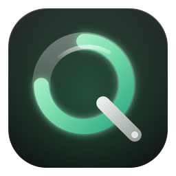
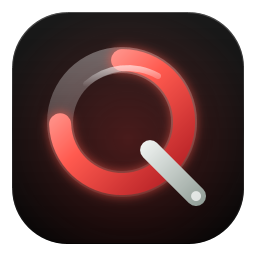
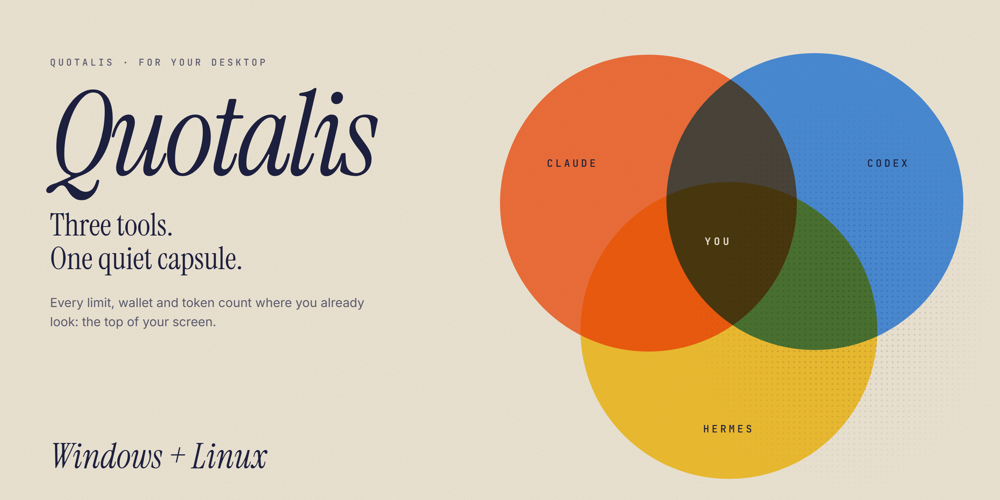
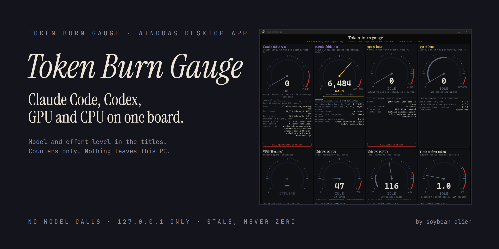

# AI Toolkit

Two separate Windows apps by **soybean_alien** for keeping an eye on your AI tools, offered as one download. Each app keeps its own repository, version, installer and release; this repository only bundles them.

| | App | What it does |
|---|---|---|
|  | **[Quotalis](https://github.com/soybean-alien/Quotalis)** | How much of your Claude, Codex and Hermes allowance is left, in a small capsule at the top of the screen. |
|  | **[Token Burn Gauge](https://github.com/soybean-alien/Token-Burn-Gauge)** | How fast your AI tools are burning tokens right now, plus GPU and CPU load, on eight dials. |

Quotalis answers "how much is left"; Token Burn Gauge answers "how fast is it going". They run side by side and don't depend on each other.

## Quotalis

Source, changelog and issues: [soybean-alien/Quotalis](https://github.com/soybean-alien/Quotalis).

## Token Burn Gauge

Source, changelog and issues: [soybean-alien/Token-Burn-Gauge](https://github.com/soybean-alien/Token-Burn-Gauge).

## Download

Get **`AI-Toolkit-Windows.zip`** from the [latest release](https://github.com/soybean-alien/AI-Toolkit/releases/latest). It holds two separate installers; run the one you want, or both:

- `Quotalis-Setup-<version>.exe`
- `TokenBurnGauge-Setup-<version>.exe`

Each installer is also attached to the release on its own, with `SHA256SUMS.txt` for all files. The installers are unsigned. Both are per-user Windows x64 installs and uninstall separately from Windows' Apps list.

## Source layout

`apps/Quotalis` and `apps/Token-Burn-Gauge` are git submodules pointing at each app's own repository, pinned to the released commit. Clone with `git clone --recurse-submodules`.

## Credits and AI disclosure

- Made by **soybean_alien**. This bundle is licensed under the **MIT License** (see [LICENSE](LICENSE)); each app carries its own license in its repository.
- Quotalis is a fork of [Developer Island](https://github.com/maximilian467/Developer-Island) by Maximilian Köhlenbeck (maximilian467), MIT.
- Claude, Codex and Hermes are their owners' products. AI Toolkit is an unofficial project and isn't affiliated with Anthropic, OpenAI or Nous Research.
- **AI disclosure:** Token Burn Gauge and this bundle were designed with and written by **Claude Code (Anthropic, Claude Opus 5.5 and Claude Fable 5.2)**, directed and tested by the author on Windows 11. See the Quotalis repository for its own disclosure.
